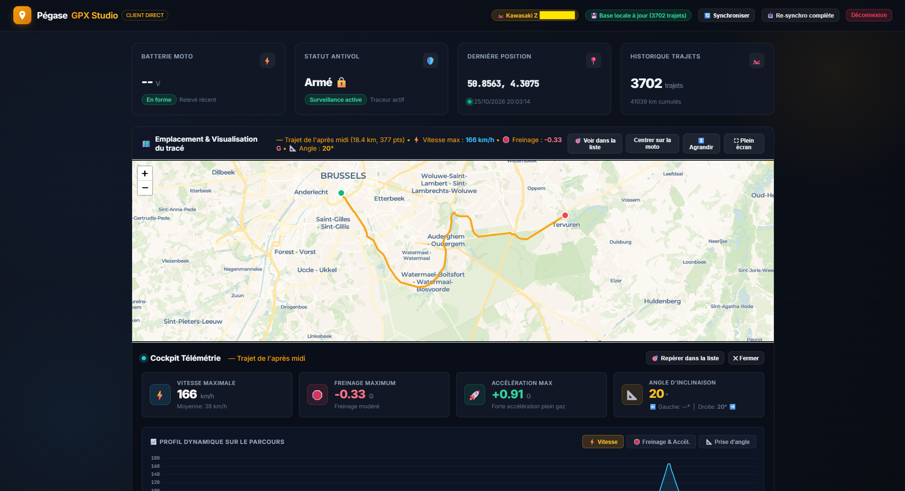
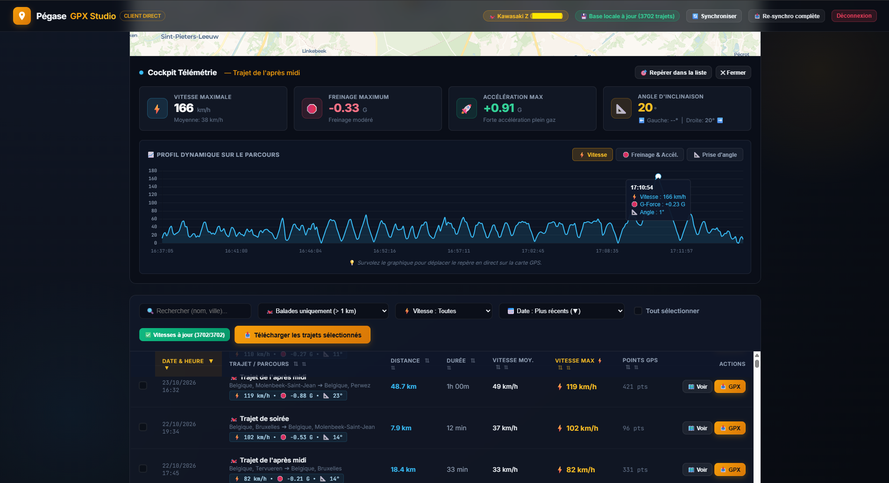
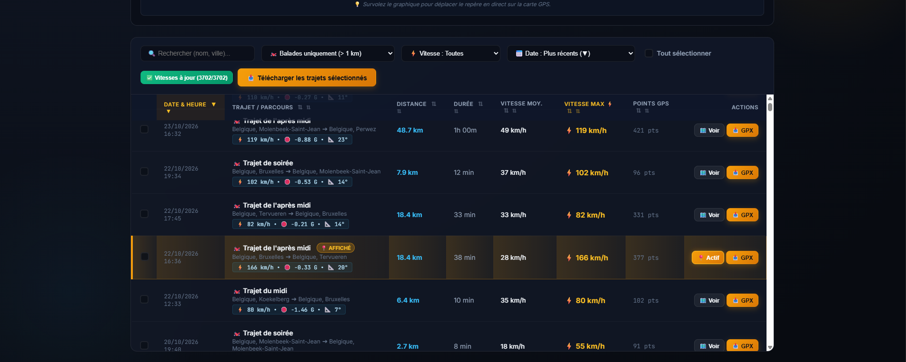
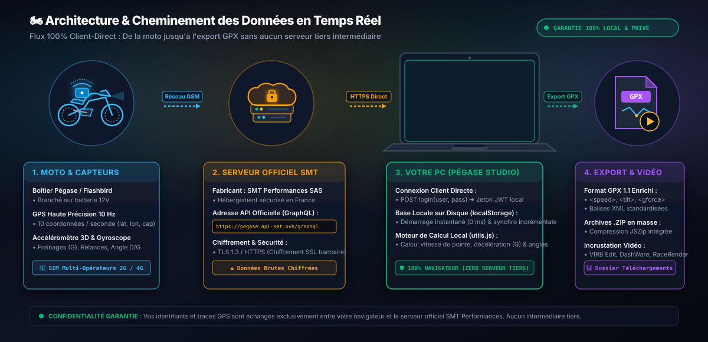

# 🏍️ Pégase & Flashbird — GPX Studio

<p align="center">
  
  
  
  
  
  
</p>

Application locale, moderne et autonome (sans serveur tiers) pour visualiser vos données de télémétrie moto, analyser vos performances au guidon et exporter vos trajets en GPX enrichi à la carte.

<div align="center">
  
</div>

---

## 🚀 Téléchargement & Utilisation (Sans Aucune Installation)

L'application ne nécessite **aucun serveur, aucun logiciel externe (pas de Node.js, pas de Python)** : elle fonctionne directement et localement dans votre navigateur web.

### 📥 1. Télécharger
* En haut à droite de cette page GitHub, cliquez sur le bouton vert **`<> Code`** puis sur **`Download ZIP`**.  
  *(Ou rendez-vous dans la section **Releases** à droite pour télécharger l'archive prête à l'emploi).*
* Faites un clic droit sur le fichier téléchargé ➔ **Extraire tout...** (par exemple sur votre Bureau).

### 🏍️ 2. Démarrer
* **Sous Windows** : Double-cliquez simplement sur **`Lancer_Pegase_Studio.bat`** (ou directement sur **`index.html`**).
* **Sous Mac & Linux** : Double-cliquez directement sur **`index.html`** dans votre navigateur (*Chrome, Edge, Firefox, Brave, Safari...*).

### 🔐 3. Connexion
* Saisissez l'adresse email et le mot de passe de votre compte Pégase / Flashbird.
* Vos identifiants contactent **directement et uniquement l'API officielle sécurisée** de SMT Performances (`https://pegase.api-smt.ovh/graphql`). Aucune donnée ne transite par un serveur tiers.

---

## ✨ Fonctionnalités Principales

### 1. 📊 Tableau de Bord & Télémétrie en Direct
* ⚡ **Tension de la batterie moto** en volts avec diagnostic de santé (*Optimale > 12.4V, Correcte, Faible < 12.0V*).
* 🛡️ **Statut antivol** (*Armé / Désarmé*) et surveillance en temps réel.
* 📍 **Dernière position GPS connue** de la moto avec coordonnées précises et date du dernier relevé.
* 🏍️ **Identification du véhicule** (Marque, modèle, plaque d'immatriculation).

### 2. 🗺️ Carte Interactive & Cockpit Télémétrie
* Visualisation de l'emplacement de votre moto en direct.
* **Affichage du tracé complet** au clic sur n'importe quel trajet avec repères de départ (vert) et d'arrivée (rouge).
* ↕️ **Agrandissement de la carte (380px ➔ 650px)** : Basculez en un clic sur le bouton **`↕️ Agrandir`** pour donner beaucoup plus de hauteur à la carte et explorer confortablement vos balades.
* ⛶ **Mode Plein Écran Immersif** : Bouton **`⛶ Plein écran`** pour afficher la carte sur 100% de votre écran avec adaptation automatique du zoom (quitter via le bouton ou avec la touche `Échap`).
* ⚡ **Cockpit Télémétrie escamotable** :
  * **Vitesse Maximale** réelle et vitesse moyenne.
  * **Freinage Maximum (en G)** : décélération record captée par l'accéléromètre avec niveau d'intensité (*freinage modéré, appuyé, d'urgence*).
  * **Accélération Maximale (en G)** : relance moteur crête.
  * **Prise d'Angle** : angle d'inclinaison maximum avec répartition **Gauche ⬅️ / Droite ➡️**.
* 📈 **Profil dynamique synchronisé avec la carte** :
  * Basculez d'un clic entre les courbes de **Vitesse**, **Freinage/Accélération** et **Angle d'inclinaison**.
  * **Curseur synchronisé :** survolez le graphique pour déplacer un point lumineux en direct sur le tracé de la carte à l'endroit exact de la mesure !

<div align="center">
  
</div>

### 3. 📋 Tableau des Trajets, Tri Bidirectionnel & Filtres Intelligents
* **Colonnes cliquables avec tri bidirectionnel instantané (▲ / ▼)** :
  * Cliquez sur n'importe quel en-tête de colonne (*Date, Vitesse Max ⚡, Distance, Durée, Vitesse Moyenne, Points GPS, Nom*) pour basculer instantanément **du plus grand au plus petit** ou **du plus petit au plus grand**.
  * Indicateurs visuels dynamiques : flèche dorée **▼** (tri décroissant) et flèche bleue **▲** (tri croissant).
* **Surlignage du trajet actif** :
  * Lorsque vous cliquez sur un trajet pour l'afficher sur la carte ou ouvrir son cockpit, sa ligne dans le tableau est immédiatement **surlignée d'un bandeau doré avec le badge `📍 Affiché`** et le bouton passe à **`📍 Actif`**.
* **Bouton de repérage rapide (🎯 Voir dans la liste)** :
  * Un bouton dédié dans l'en-tête de la carte et du cockpit permet de faire défiler automatiquement la page jusqu'au trajet sélectionné et de le faire pulser pour le retrouver d'un coup d'œil parmi des milliers de balades.
* **Filtres rapides en en-tête** :
  * 🔍 **Recherche textuelle** par nom de balade, ville ou lieu-dit.
  * 🛣️ **Filtre par type de trajet** : masquer automatiquement les micro-dérives de parking (< 1 km / < 50 pts), isoler les virées (> 10 km) ou les grands voyages (> 50 km).
  * ⚡ **Filtre par Vitesse Max** : isoler les balades dynamiques (> 90 km/h, > 130 km/h).
  * ⇅ **Menu de tri complet** : synchronisé en temps réel avec les clics sur les colonnes.
* **Indicateur de Points GPS (pts)** : nombre de coordonnées enregistrées par le boîtier (permet de distinguer les vraies sorties des micro-mouvements parasites de parking).

<div align="center">
  
</div>

### 4. 💾 Base Locale & Synchronisation Incrémentale (0 ms d'attente)
* **Démarrage instantané (0 ms) :** Tous vos trajets (même plus de 3 000) sont enregistrés de façon permanente dans le stockage local de votre navigateur (`localStorage` sur votre disque dur). Lorsque vous ouvrez ou rechargez l'application (`F5`), l'historique complet est disponible instantanément.
* **Synchronisation Incrémentale Intelligente (🔄 Synchroniser) :** Au lieu de re-télécharger des milliers de données, l'application vérifie uniquement les trajets récents. S'il n'y a aucun nouveau trajet, le serveur Pégase n'est plus sollicité. Si vous avez fait une nouvelle virée, elle est automatiquement ajoutée et sauvegardée.
* **Cache Télémétrie Persistant :** Les vitesses maximales, accélérations et angles d'inclinaison calculés restent en mémoire sur votre PC et ne sont jamais recalculés deux fois.
* **Re-synchronisation Complète (📥 Re-synchro complète) :** Un bouton dédié permet à tout moment de forcer un re-téléchargement intégral de l'historique depuis les serveurs officiels Pégase.

### 5. 📥 Export GPX Enrichi (Compatible Vidéo GoPro / Virb)
* **Sélection multiple par cases à cocher** ou bouton *Tout sélectionner*.
* **Téléchargement sur-mesure** : export individuel en fichier `.gpx` ou groupé dans une archive compressée `.zip`.
* **Extensions de télémétrie complètes GPX 1.1** : intégration des balises de vitesse (`<speed>`), angle (`<tilt>`), accélération/freinage (`<acceleration>`, `<gforce>`) et cap (`<course>`), prêtes pour l'incrustation de compteurs vidéo dans *Garmin VIRB Edit*, *DashWare* ou *RaceRender*.

---

## 🏗️ Architecture & Flux des Données

<div align="center">
  
</div>

### 📁 Organisation Modulaire du Code Source

Le code est entièrement découpé en modules légers et lisibles pour faciliter la personnalisation et la maintenance :

```
Pegase_Manager/
├── index.html            — Structure HTML épurée (aucun script inline)
├── styles.css            — Design system complet (dark theme, glassmorphism, responsive)
├── images/               — Schémas d'architecture et captures d'écran
│   ├── flux_donnees.svg
│   ├── cockpit_carte.png
│   ├── profil_dynamique.png
│   └── tableau_trajets.png
├── js/
│   ├── config.js         — ⚙️ Paramètres modifiables (endpoints API, clé carto CARTO, zoom par défaut)
│   ├── api.js            — 🔌 Client GraphQL direct vers l'API SMT
│   ├── utils.js          — 🔧 Moteur de calcul (parsers de timestamps, conversion G-Force, moyennes)
│   ├── map.js            — 🗺️ Moteur cartographique Leaflet (marqueurs, polylines, synchronisation)
│   ├── cockpit.js        — ⚡ Panneau escamotable et graphiques dynamiques Chart.js
│   ├── rides.js          — 📊 Tableau des trajets, filtres avancés, tri et mise en cache
│   ├── gpx.js            — 📥 Moteur de génération des fichiers GPX et création de ZIP
│   ├── auth.js           — 🔐 Gestion de la connexion, du token de session et de la déconnexion
│   └── app.js            — 🚀 Initialisation et orchestration générale
├── Lancer_Pegase_Studio.bat — Lanceur rapide sous Windows
└── README.md             — Documentation complète du projet
```

### ⚙️ Comment personnaliser l'application ?
* **Changer la clé de carte ou l'API** ➔ Éditez [`js/config.js`](file:///c:/Users/Farisse/Pegase_Manager/js/config.js).
* **Modifier les couleurs ou le style** ➔ Éditez [`styles.css`](file:///c:/Users/Farisse/Pegase_Manager/styles.css).
* **Personnaliser les indicateurs de télémétrie** ➔ Éditez [`js/cockpit.js`](file:///c:/Users/Farisse/Pegase_Manager/js/cockpit.js).

---

## 🔒 Sécurité et Confidentialité

* **100% Local & Sans Serveur Tiers :** L'application s'exécute exclusivement dans votre navigateur web (`index.html`).
* **Connexion Directe Officielle :** Vos identifiants et votre jeton d'authentification contactent directement et uniquement l'API officielle sécurisée de SMT Performances (`https://pegase.api-smt.ovh/graphql`).
* **Zéro Télémétrie Externe :** Vos trajets, vos vitesses et vos données GPS ne sont jamais envoyés à un serveur tiers ou un service d'analyse.

---

## 🌍 Compatibilité Traceurs, Réseaux, Pays & Motos

### 📡 Boîtiers GPS & Réseaux Mobiles Pris en Charge
* ⚡ **Pégase Moto (2G)** : Connexion GSM européenne sans abonnement.
* ⚡ **Flashbird & Flashbird Celeris (4G / LTE-M / NB-IoT)** : Réseau cellulaire nouvelle génération ultra-rapide et basse consommation.

### 🗺️ Pays Couverts (+ de 100 pays)
Les boîtiers Pégase et Flashbird embarquent une carte SIM multi-opérateurs internationale active dans plus de 100 pays :
* 🇫🇷 **France** (Métropole et Corse)
* 🇧🇪 **Belgique**
* 🇨🇭 **Suisse** & 🇱🇺 **Luxembourg**
* 🇪🇺 **Toute l'Union Européenne & Europe** (*Espagne, Italie, Allemagne, Portugal, Pays-Bas, Autriche, Royaume-Uni, etc.*)
* 🌍 **International** (*Maroc, Tunisie, États-Unis, Canada, etc. selon couverture partenaire SMT Performances*).

### 🏍️ Toutes Marques de Motos & Deux-Roues
L'outil est 100% universel et fonctionne avec toutes les motos et cylindrées équipées d'un boîtier SMT Performances relié à une batterie 12V :
* **Kawasaki** (*Ninja, Z900, Z650, Versys, ZX-6R, ZX-10R...*)
* **Yamaha** (*MT-07, MT-09, Tracer, Ténéré 700, R1, R7...*)
* **Honda** (*CB650R, CB500F, Africa Twin, Hornet, CBR, Transalp...*)
* **BMW Motorrad** (*R 1250 GS, S 1000 RR, F 900 R, R 1300 GS...*)
* **Ducati** (*Monster, Panigale, Multistrada, Streetfighter, Hypermotard...*)
* **KTM & Husqvarna** (*Duke 790/890/1290, Super Adventure, Norden...*)
* **Triumph** (*Street Triple, Speed Triple, Tiger, Bonneville...*)
* **Suzuki, Aprilia, Harley-Davidson, Moto Guzzi, Royal Enfield...**
* **Scooters & Maxi-Scooters** (*Yamaha TMAX, XMAX, Honda X-ADV, Forza...*)

---

## 🏷️ Mots-Clés / Tags

`pegase-moto` • `flashbird` • `smt-performances` • `motorcycle` • `moto` • `traceur-gps` • `gps-tracker` • `telemetry` • `telemetrie` • `gpx` • `gpx-exporter` • `leaflet` • `chartjs` • `local-first` • `privacy-focused` • `france` • `belgique` • `kawasaki` • `yamaha` • `honda` • `bmw-motorrad` • `ducati` • `ktm` • `triumph`

---

## ⚖️ Avertissement & Mentions Légales

Ce projet est un outil tiers indépendant et open source développé pour la communauté motarde. Il n'est **ni affilié, ni sponsorisé, ni soutenu par la société SMT Performances**. *Pégase Moto* et *Flashbird* sont des marques déposées de SMT Performances.

